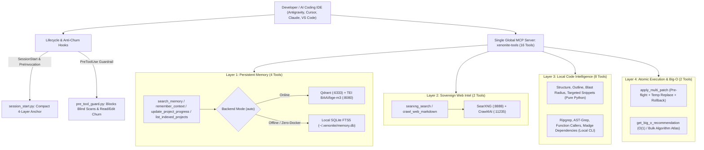

<div align="center">

# ⚡ XENONITE STACK
### *Self-Hosted 4-Layer Autonomous Engineering MCP Stack & Anti-Churn Guardrails for AI Coding Agents*

[](https://github.com/Muhammad-Rizqullah-Akbar)
[](LICENSE)
[](https://www.python.org/)
[](https://modelcontextprotocol.io/)
[](docker/docker-compose.yml)
[](CONTRIBUTING.md)

<p align="center">
  
</p>

[Why Xenonite](#-why-xenonite) • [4-Layer Architecture](#-4-layer-architecture) • [Quickstart](#-quickstart-3-minute-setup) • [Deployment Profiles](#-deployment-profiles-lite-vs-full-vs-remote-hub) • [16 MCP Tools](#-complete-16-mcp-tool-reference) • [CLI Reference](#-cli-command-reference) • [Verification](#-automated-verification) • [Contributing](#-contributing)

---
</div>

> [!NOTE]
> **AI-Assisted Documentation:** Dokumentasi `README.md` ini disusun bersama AI berdasarkan struktur kode aktual, modul MCP, hooks, dan rangkaian pengujian terverifikasi di dalam repositori ini.

> [!IMPORTANT]
> **Minimum Turn, Maximum Result:** Xenonite Stack mengubah AI coding agent (Antigravity, Claude Desktop, Cursor, Windsurf, VS Code, Hermes) dari pola boros token (membaca file penuh satu per satu, memindai folder rekursif, dan mengedit file berulang kali) menjadi mesin rekayasa 4-layer yang hemat token, sadar dampak perubahan (*blast radius*), ber-memori persisten, dan terkunci secara mekanis melalui `PreToolUse` Anti-Churn Guardrails.

---

## 🎯 Why Xenonite?

Sebagian besar AI coding agent mengalami 4 pemborosan kronis pada proyek nyata:
1. **Context Amnesia:** Setiap sesi/tab baru mulai dari nol, berulang kali memindai struktur proyek untuk memahami kontrak arsitektur yang sama.
2. **HTML/DOM Bloat:** Mencari dokumentasi web menyedot puluhan ribu token berisi navbar, iklan, dan markup HTML mentah.
3. **Micro-Tool Read/Edit Churn:** Agen memanggil `read_file` 10 kali berturut-turut dan `edit_file` 8 kali satu per satu, membuang kuota turn serta context window.
4. **Blind Modifications:** Mengubah fungsi bersama tanpa mengecek *callers*, *blast radius*, atau *circular dependencies*.

**Xenonite Stack** menyelesaikan keempatnya melalui satu server MCP global (`xenonite-tools`, 16 tools modular) yang dipadukan dengan hook `SessionStart`, `PreInvocation`, dan `PreToolUse` lintas OS.

---

## 🏗️ 4-Layer Architecture



### Fitur Utama
- **Dual-Backend Layer 1 Memory (`auto` mode):** Menggunakan **Qdrant + TEI (`BAAI/bge-m3`)** untuk pencarian vektor semantik 1024-dimensi (otomatis membuat koleksi bila belum ada), dan otomatis *fallback* ke **SQLite FTS5 lokal** (`~/.xenonite/memory.db`) saat Docker sedang mati. Semua 16 tool langsung bekerja di menit pertama!
- **Sovereign Web Research (Layer 2):** Pencarian multi-mesin bebas *filter bubble* via **SearXNG** dan ekstraksi halaman web menjadi Clean Markdown bebas noise DOM via **Crawl4AI**.
- **Surgical Code Intelligence (Layer 3):** Pemetaan struktur, ekstraksi outline simbol, kalkulasi *blast radius*, *call graph*, pencarian cepat `ripgrep` (dilengkapi *fallback* regex Python bila `rg` belum terpasang), pencarian sintaksis `ast-grep`, graf dependensi `madge`, dan pembacaan banyak potongan baris lintas file dalam 1 panggilan (`read_targeted_snippets`).
- **True Atomic Multi-Patch (Layer 4):** Mendukung beberapa patch berantai pada file yang sama maupun lintas banyak file dalam 1 panggilan atomik dengan validasi *pre-flight*, penulisan via temp-file replace, dan **rollback penuh** bila ada target yang gagal cocok.
- **Deterministic Anti-Churn Guardrails:** Hook `PreToolUse` mencegat *blind recursive scan* (`Get-ChildItem -Recurse`, `dir /s`, `grep -r`, `find . -name`, `os.walk`) serta perulangan `read_file`/`edit_file` satu per satu, sambil tetap *fail-open* dan meloloskan `SKILL.md`, media, serta brain artifacts.
- **Safe Non-Destructive Installer:** `xenonite install` menggabungkan (*merge*) entri MCP dan hook ke `~/.gemini/config` tanpa menghapus server MCP atau hook milik proyek lain, lengkap dengan backup `.bak` otomatis dan perintah `xenonite uninstall`.

---

## 🚀 Quickstart (3-Minute Setup)

### Prasyarat Minimum
- **Python 3.10+** (Windows, macOS, atau Linux)
- *(Opsional - sangat direkomendasikan)* CLI Layer 3: [`ripgrep`](https://github.com/BurntSushi/ripgrep) (`rg`), [`ast-grep`](https://ast-grep.github.io/) (`sg`), dan [`madge`](https://github.com/pahen/madge) (`npm i -g madge`)
- *(Opsional - untuk Full Self-Hosted L1 Vector & L2 Web Intel)* **Docker Engine / Docker Desktop**

### Langkah 1: Clone & 1-Click Bootstrap

```bash
git clone https://github.com/Muhammad-Rizqullah-Akbar/xenonite-stack.git
cd xenonite-stack

# Windows (1-click venv + install + audit + menu interaktif):
.\bootstrap.bat

# Linux / macOS:
chmod +x bootstrap.sh && ./bootstrap.sh
```

Atau install manual di virtual environment Anda:

```bash
python -m venv .venv
# Windows: .venv\Scripts\activate
# Unix   : source .venv/bin/activate
pip install -e .
cp .env.example .env
```

### Langkah 2: Audit Lingkungan (`xenonite check`)

```bash
xenonite check
```

Contoh keluaran audit sistem:

```text
================================================================================
            XENONITE STACK v1.0.0 - PRE-FLIGHT SYSTEM AUDIT
================================================================================

[1] CORE PYTHON RUNTIME & MCP SDK:
    |- [OK] Python 3.12.x (Windows/Linux/macOS)
    |- [OK] MCP Python SDK (`mcp`) : installed
    +- [OK] uv (optional runner)  : /usr/local/bin/uv

[2] LAYER 3 LOCAL CODE INTELLIGENCE BINARIES:
    |- [OK] ripgrep (`rg`)        : /usr/bin/rg
    |- [OK] ast-grep (`sg`)       : /usr/local/bin/sg
    +- [OK] madge (`madge`)       : /usr/local/bin/madge

[3] LAYER 1 PERSISTENT MEMORY (mode=auto):
    |- [OK] Qdrant (http://127.0.0.1:6333) : HTTP 200
    |- [OK] TEI Embedder (http://127.0.0.1:8080) : HTTP 200
    +- [OK] SQLite FTS5 Fallback  : ~/.xenonite/memory.db

[4] LAYER 2 SOVEREIGN WEB INTELLIGENCE (OPTIONAL DOCKER):
    |- [OK] Docker CLI            : /usr/bin/docker
    |- [OK] SearXNG (http://127.0.0.1:8888) : HTTP 200
    +- [OK] Crawl4AI (http://127.0.0.1:11235) : HTTP 200

[5] ANTIGRAVITY / GEMINI INTEGRATION (~/.gemini/config):
    |- [OK] Global MCP (`xenonite-tools`)  : registered
    |- [OK] Anti-Churn Hooks (`hooks.json`): active
    +- [OK] 4-Layer Rules (`rules/*.md`)   : present
================================================================================
ACTIVE PROFILE: FULL SOVEREIGN STACK (L1 Vector + L2 Web Intel + L3 Code Intel + L4 Atomic)
================================================================================
```

### Langkah 3: Pasang ke AI Coding IDE Anda

#### A. Antigravity / Gemini Global Setup (Otomatis - 1 Perintah)
Menggabungkan `xenonite-tools` ke `~/.gemini/config/mcp_config.json`, memasang Anti-Churn Hooks ke `hooks.json`, serta menyalin Rules & Skills portabel:

```bash
# Default: aturan profesional netral (direkomendasikan untuk umum)
xenonite install

# Opsional: gunakan persona Mr. Robot (Snappy Protocol)
xenonite install --persona mr-robot

# Pratinjau perubahan tanpa menulis ke disk
xenonite install --dry-run
```

#### B. Claude Desktop / Cursor / Windsurf / VS Code
Cetak potongan JSON MCP siap tempel untuk klien MCP lain:

```bash
# Format standar mcpServers (Claude Desktop, Cursor, Windsurf, Hermes)
xenonite print-mcp

# Format VS Code (.vscode/mcp.json)
xenonite print-mcp --client vscode
```

Lalu **restart AI IDE Anda** agar server MCP `xenonite-tools` aktif.

---

## 🌐 Deployment Profiles: Lite vs Full vs Remote Hub

Pilih mode yang paling cocok dengan spesifikasi perangkat Anda:

| Profile | Kebutuhan | Cara Mengaktifkan | Cocok Untuk |
| :--- | :--- | :--- | :--- |
| **1. Portable Lite (Zero-Docker)** | Python 3.10+ saja | Langsung aktif default (`XENONITE_MEMORY_BACKEND=auto`) | Laptop tipis, device baru tanpa Docker, kerja cepat L1 SQLite + L3 + L4 |
| **2. Full Local Docker (CPU)** | Python + Docker | `xenonite docker up full` | Workstation mandiri dengan Qdrant + TEI (`BAAI/bge-m3`) + SearXNG + Crawl4AI |
| **3. Full Local Docker (NVIDIA GPU)** | Python + Docker + NVIDIA Container Toolkit | `xenonite docker up full --gpu` | Embedding TEI super cepat dengan akselerasi CUDA |
| **4. Multi-Device Remote Hub (Tailscale / LAN)** | 1 PC/VPS utama + laptop lain | Jalankan Docker di PC utama, lalu isi IP Tailscale di `.env` laptop kedua | **Sinkronisasi memori lintas banyak device** tanpa membebani laptop kedua |

### Contoh `.env` untuk Multi-Device Remote Hub (Tailscale)

Di laptop kedua (tanpa Docker lokal), cukup salin `.env.example` ke `.env` dan arahkan ke PC utama/VPS Anda:

```dotenv
XENONITE_MEMORY_BACKEND=auto
XENONITE_QDRANT_URL=http://100.x.y.z:6333
XENONITE_TEI_URL=http://100.x.y.z:8080/embed
XENONITE_SEARXNG_URL=http://100.x.y.z:8888
XENONITE_CRAWL4AI_URL=http://100.x.y.z:11235
```

> [!TIP]
> Saat laptop sedang offline (tidak terhubung ke VPN/Tailscale), mode `XENONITE_MEMORY_BACKEND=auto` otomatis turun dengan mulus ke **SQLite FTS5 lokal** sehingga alur kerja tidak pernah macet.

---

## 🛠️ Complete 16 MCP Tool Reference

Seluruh 16 tool terdaftar pada server tunggal `xenonite-tools`:

### Layer 1: Persistent Memory (`xenonite_stack/mcp/layer1_memory.py`)
| Tool | Argumen | Fungsi |
| :--- | :--- | :--- |
| `search_memory` | `query, project?, domain?, limit?` | Pencarian semantik (Qdrant+TEI) atau BM25 FTS5 (SQLite) |
| `remember_context` | `project, title, content, domain?, module?, tags?, files?, status?` | Menyimpan keputusan arsitektur, kontrak API, atau ADR secara idempoten |
| `update_project_progress` | `project, feature, status, note, files?` | Mencatat milestone & progres fitur (`ready`, `in_progress`, `planned`, `blocked`) |
| `list_indexed_projects` | `{}` | Menampilkan daftar proyek beserta domain yang terindeks |

### Layer 2: Sovereign Web Intelligence (`xenonite_stack/mcp/layer2_intel.py`)
| Tool | Argumen | Fungsi |
| :--- | :--- | :--- |
| `searxng_search` | `query, max_results?, category?` | Meta-search multi-mesin bebas bias SEO via SearXNG JSON API |
| `crawl_web_markdown` | `url, mode?, query?` | Ekstraksi halaman web dinamis (Playwright) ke Clean Markdown via Crawl4AI |

### Layer 3: Local Code Intelligence (`xenonite_stack/mcp/layer3_code_intel.py`)
| Tool | Argumen | Fungsi |
| :--- | :--- | :--- |
| `get_project_structure` | `root_dir?, max_depth?` | Pohon direktori ringkas dengan filter otomatis folder cache/build |
| `get_code_outline` | `file_path` | Ekstraksi simbol deklarasi (class, struct, interface, function, method) + nomor baris |
| `analyze_blast_radius` | `target_file, search_dir` | Mendeteksi seluruh berkas yang mengimpor/terdampak oleh `target_file` |
| `analyze_function_callers` | `function_name, search_dir?, max_results?` | Melacak seluruh titik pemanggilan fungsi (*call graph*) lintas proyek |
| `analyze_module_dependencies` | `target_path, circular_only?` | Pemetaan dependensi modul JS/TS & deteksi *circular import* via Madge |
| `ripgrep_search` | `pattern, search_path?, file_type?, max_results?` | Pencarian regex kecepatan tinggi via `rg` (dengan *fallback* Python otomatis) |
| `ast_grep_search` | `pattern, search_path?, language?, max_results?` | Pencarian pola struktural AST lintas bahasa via `sg` (`ast-grep`) |
| `read_targeted_snippets` | `snippets: [{file_path, start_line, end_line, label?}]` | Membaca banyak potongan baris lintas file sekaligus dalam 1 panggilan |

### Layer 4: Atomic Execution & Big-O (`xenonite_stack/mcp/layer4_execution.py`)
| Tool | Argumen | Fungsi |
| :--- | :--- | :--- |
| `apply_multi_patch` | `patches: [{path, target, replacement}]` | Modifikasi multi-titik/multi-file atomik dengan pre-flight & rollback otomatis |
| `get_big_o_recommendation` | `domain_pattern` | Kamus rekomendasi algoritma & struktur data Big-O optimal |

---

## 🎛️ CLI Command Reference

```text
xenonite <subcommand> [options]
```

| Perintah | Deskripsi |
| :--- | :--- |
| `xenonite check` | Menjalankan Pre-Flight System Audit (Python, MCP SDK, CLI L3, L1/L2 services, status integrasi IDE) |
| `xenonite install [--persona standard\|mr-robot] [--dry-run] [--no-hooks] [--use-uv]` | Memasang MCP, hooks anti-churn, rules, dan skills ke `~/.gemini/config` secara non-destruktif |
| `xenonite uninstall` | Menghapus entri Xenonite secara bersih tanpa menyentuh konfigurasi MCP/hook lain |
| `xenonite print-mcp [--client generic\|vscode]` | Mencetak blok konfigurasi JSON MCP siap tempel |
| `xenonite serve` | Menjalankan server MCP stdio `xenonite-tools` secara langsung |
| `xenonite verify [--mode all\|security\|hooks\|mcp]` | Menjalankan gerbang validasi *silent-filtered* |
| `xenonite docker <up\|down\|status\|logs> [full\|memory\|intel] [--gpu]` | Mengelola container Docker self-hosted Layer 1 & Layer 2 |
| `xenonite memory <status\|init-qdrant>` | Melihat proyek terindeks atau inisialisasi koleksi Qdrant secara eksplisit |

---

## ✅ Automated Verification

Jalankan seluruh verifikasi keamanan, hooks anti-churn (11 skenario deterministik), dan unit test L1-L4:

```bash
# Silent-filtered verification gate (0 em-dash, hooks latency, L1/L3/L4 smoke test)
xenonite verify

# Full Python unit test suite
python -m unittest discover -s tests -p "test_*.py" -v
```

---

## 📁 Modular Repository Structure

```text
xenonite-stack/
├── README.md
├── LICENSE
├── CONTRIBUTING.md
├── CHANGELOG.md
├── pyproject.toml
├── .env.example
├── .gitignore
├── bootstrap.bat                    # 1-Click Windows Bootstrap + Interactive Menu
├── bootstrap.sh                     # 1-Click Linux/macOS Bootstrap
├── Makefile                         # Cross-platform operator targets
├── docker/
│   ├── docker-compose.yml           # Self-hosted Qdrant + TEI (CPU) + SearXNG + Crawl4AI
│   ├── docker-compose.gpu.yml       # Optional NVIDIA CUDA override for TEI
│   └── searxng/settings.yml         # JSON API enabled out-of-the-box
├── templates/
│   ├── rules/
│   │   ├── xenonite-4layer.md       # Clean neutral 4-Layer Always-On rules
│   │   └── mr-robot-persona.md      # Optional Mr. Robot Snappy Protocol pack
│   └── skills/
│       ├── xeno-memory/SKILL.md     # Portable Layer 1 memory workflow skill
│       └── xeno-intel/SKILL.md      # Portable Layer 2 web intel workflow skill
├── xenonite_stack/
│   ├── config.py                    # Unified env/.env loader & binary resolver
│   ├── mcp/
│   │   ├── server.py                # FastMCP("xenonite-tools") 16-tool registry
│   │   ├── layer1_memory.py         # Qdrant+TEI + auto SQLite FTS5 fallback
│   │   ├── layer2_intel.py          # SearXNG + Crawl4AI
│   │   ├── layer3_code_intel.py     # Structure, Outline, Blast Radius, rg/sg/madge, Snippets
│   │   └── layer4_execution.py      # Atomic Multi-Patch (rollback) + Big-O Atlas
│   ├── hooks/
│   │   ├── session_start.py         # SessionStart & PreInvocation anchor hook
│   │   └── pre_tool_guard.py        # Deterministic PreToolUse Anti-Churn Guardrail
│   └── cli/
│       ├── app.py                   # Unified `xenonite` CLI entrypoint
│       ├── diagnostics.py           # `xenonite check` Pre-Flight System Audit
│       ├── installer.py             # Non-destructive merge installer & uninstaller
│       └── verifier.py              # `xenonite verify` silent-filtered gate
└── tests/
    └── test_xenonite_stack.py       # Unit & integration tests (L1, L3, L4, Hooks, Installer)
```

---

## 🤝 Contributing

Kontribusi terbuka lebar untuk seluruh developer dan praktisi AI engineering! Silakan baca [CONTRIBUTING.md](CONTRIBUTING.md) untuk panduan setup pengembangan, standar kualitas kode, dan area kontribusi.

---

## 📄 License

Dirilis di bawah lisensi **MIT** - lihat berkas [LICENSE](LICENSE) untuk rincian lengkap.

Copyright (c) 2026 **Muhammad-Rizqullah-Akbar** & Contributors.
